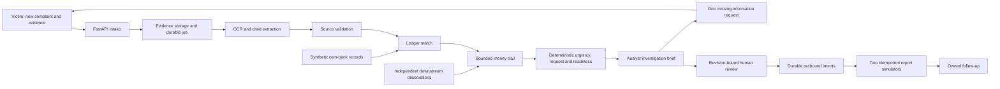

# Architecture

The primary user is a bank payment-scam response analyst. The victim interface is
a bank reporting and clarification channel. Synthetic demonstration identities
and records are explicitly labeled throughout.

The brief contains payment inventory, chronology, citations, conflicts, unknowns,
recommended action and review rationale. Victim statements, own-bank records and
downstream observations preserve separate provenance and observation times.
Unknown or stale data cannot silently become verified. Unsupported urgent action
and a complete handoff have distinct eligibility rules.

Approvals bind to a case revision and digest. New material invalidates stale
approval; prior decisions remain in history. Durable jobs and outbound intents
survive retries, lease loss and lost acknowledgements. Receivers deduplicate by
idempotency key. A delivered packet remains open for follow-up.

## Local packaging

`Dockerfile.app` builds static React assets with pinned Node, then serves them
from FastAPI. `local_services.application` supervises web, OCR, feed, report
receiver and worker processes. Internal listeners bind to loopback; only web port
8080 is published on host loopback. `/ready` checks dependencies and worker health.
An essential child exit stops the container, and the restart policy recovers it.
Persistent bank preload is idempotent and creates no complaint.

`Dockerfile` and `docker/compose.services.yaml` retain the separate-service testing
harness. Invoke that configuration with `--project-directory .` so paths resolve
from the repository root; do not run both packages on the same published port.

## Google target

Use separately deployed services and attached identities for API, worker, scanner
and simulators. Google mode rejects silent local-storage/OCR/model fallbacks.
Cloud Armor protects edge requests; a private malware scanner separately gates
quarantine promotion. See `infra/google/README.md`. Local packaging changes do
not authorize Terraform apply, image publication or deployment.
